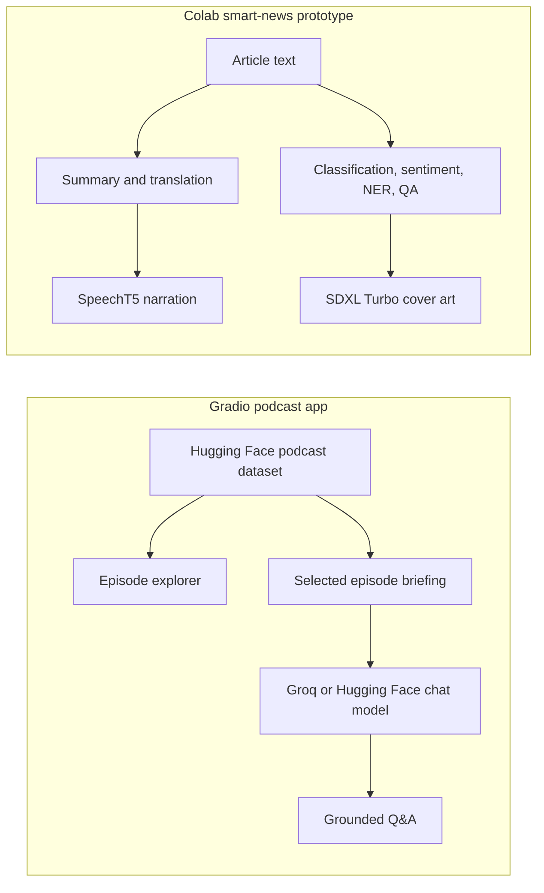

# ⚡ Latent Space Chat & Smart News Producer

[](https://huggingface.co/)
[](https://www.python.org/)
[](https://www.gradio.app/)
[](https://www.apache.org/licenses/LICENSE-2.0)

An AI media project containing two complementary experiments:

- **Latent Space Chat** — a Gradio app for browsing, listening to, and asking grounded questions about episodes in the [Latent Space podcast archive](https://huggingface.co/datasets/Faraz-Ahmad/latent-space-podcast-archive).
- **Smart News & Podcast Producer** — a Google Colab notebook that turns an article into structured analysis, a translated summary, cover art, and narrated audio using Hugging Face models.

> [!NOTE]
> The notebook is a standalone multimodal news-processing prototype. It does not currently generate the dataset consumed by the Gradio app.

## Features

### Latent Space Chat (`app.py`)

- Loads podcast episode metadata and briefings from Hugging Face Datasets.
- Lets users select an episode, stream its audio, and read its executive briefing.
- Answers questions using only the selected episode's briefing as context.
- Uses Groq first and falls back to Hugging Face Inference when needed.
- Refreshes the archive from the Hub without restarting the app.
- Includes compatibility handling for Gradio/Pydantic schema issues.

### Smart News Producer (`Smart_News_and_Podcast_Producer.ipynb`)

The notebook demonstrates an end-to-end multimodal workflow:

1. Zero-shot topic classification
2. Sentiment analysis
3. Named-entity recognition
4. Extractive question answering
5. Article summarization
6. English-to-Spanish translation
7. AI cover-image generation with SDXL Turbo
8. Text-to-speech narration with SpeechT5

## Architecture



## Project Structure

```text
Smart_News_and_Podcast_Producer/
├── app.py                                 # Gradio podcast explorer and chat app
├── Smart_News_and_Podcast_Producer.ipynb # Colab multimodal news workflow
├── requirements.txt                      # Dependencies for the Gradio app
└── README.md                             # Project documentation and Space metadata
```

## Run the Gradio App Locally

### Prerequisites

- Python 3.12 (matching the Hugging Face Space configuration)
- A Groq API key and/or Hugging Face access token

### Installation

From the repository root:

```bash
cd hugging-face-google-colab/Smart_News_and_Podcast_Producer
python -m venv .venv
```

Activate the environment:

```bash
# Windows PowerShell
.\.venv\Scripts\Activate.ps1

# macOS/Linux
source .venv/bin/activate
```

Install the dependencies and launch the app:

```bash
pip install -r requirements.txt gradio==5.20.0
python app.py
```

Open `http://localhost:7860` in your browser.

## Environment Variables

| Variable | Required | Purpose |
| --- | --- | --- |
| `GROQ_API_KEY` | Recommended | Enables the preferred low-latency chat backend. |
| `HF_TOKEN` | Recommended | Authenticates requests to Hugging Face Hub and Inference. |

You can set these in your shell or in a local `.env` file:

```env
GROQ_API_KEY=your_groq_api_key
HF_TOKEN=your_hugging_face_token
```

Never commit real API keys or tokens to Git.

## Run the Notebook in Google Colab

[](https://colab.research.google.com/github/farazahmad-ai/AI-Engineering-Projects/blob/main/hugging-face-google-colab/Smart_News_and_Podcast_Producer/Smart_News_and_Podcast_Producer.ipynb)

1. Open the notebook with the badge above.
2. Select a GPU runtime: **Runtime → Change runtime type → T4 GPU**.
3. Add any requested Hugging Face credentials through Colab Secrets.
4. Replace the sample `article_text` with your own content.
5. Run the cells in order to generate the analysis, summary, translation, image, and narration.

Model downloads and image generation can require several gigabytes of memory and may run slowly without a GPU.

## Deploy to Hugging Face Spaces

Create a Gradio Space, then upload `app.py`, `requirements.txt`, and this `README.md`. Add `GROQ_API_KEY` and `HF_TOKEN` under **Settings → Variables and secrets**. The YAML block at the top of this file configures the Space runtime.

## Current Limitations

- Chat context is limited to the first 3,000 characters of an episode briefing.
- Conversation history is displayed in the UI but is not sent back to the model for multi-turn reasoning.
- The app depends on the availability and schema of the external podcast dataset.
- The notebook uses pipeline defaults for several NLP tasks, so results and download sizes can vary with the installed Transformers version.
- Generated summaries, translations, images, and audio should be reviewed before publication.

## Responsible Use

Only process content you are authorized to use. Verify generated facts, translations, and quotations against the original source, and follow the licenses and usage terms of the datasets and models you select.

## License

This project is configured for the [Apache License 2.0](https://www.apache.org/licenses/LICENSE-2.0). Add a `LICENSE` file to the repository if one is not already present before distributing the project under these terms.
